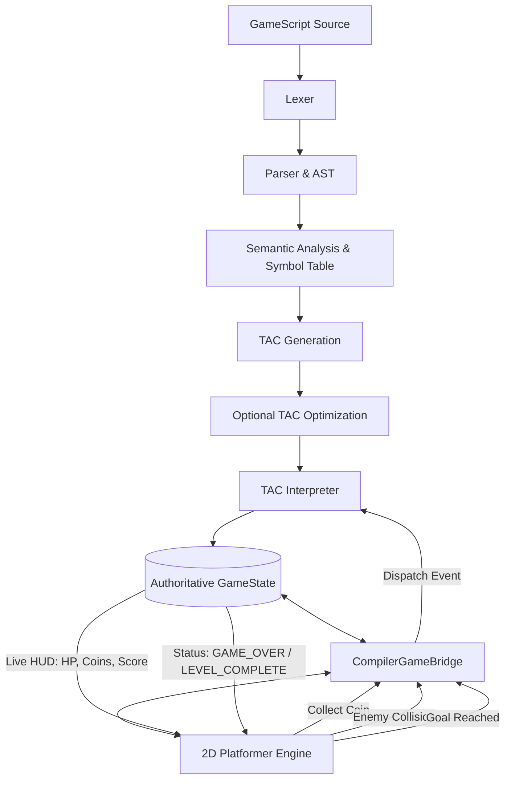

# GameForge — GameScript Compiler

> A beginner-friendly, full-pipeline compiler for the GameScript domain-specific language, built as a college Compiler Design project.

---

## Table of Contents

1. [Project Overview](#1-project-overview)
2. [GameScript Language Overview](#2-gamescript-language-overview)
3. [Compiler Architecture](#3-compiler-architecture)
4. [Phase 1 — Lexical Analysis](#4-phase-1--lexical-analysis)
5. [Phase 2 — Syntax Analysis](#5-phase-2--syntax-analysis)
6. [Phase 3 — Semantic Analysis](#6-phase-3--semantic-analysis)
7. [Phase 4 — TAC Generation](#7-phase-4--tac-generation)
8. [Three-Address Code Instruction Format](#8-three-address-code-instruction-format)
9. [TAC Examples](#9-tac-examples)
10. [Phase 5 — Optional Optimization](#10-phase-5--optional-optimization)
11. [Phase 6 — TAC Interpreter](#11-phase-6--tac-interpreter)
12. [Runtime Event Handling](#12-runtime-event-handling)
13. [Phase 7 — UI Features](#13-phase-7--ui-features)
14. [Installation and Dependencies](#14-installation-and-dependencies)
15. [How to Run the Terminal Compiler](#15-how-to-run-the-terminal-compiler)
16. [How to Launch the UI](#16-how-to-launch-the-ui)
17. [How to Run Tests](#17-how-to-run-tests)
18. [Example Outputs](#18-example-outputs)
19. [Current Limitations](#19-current-limitations)
20. [Future AI Integration](#20-future-ai-integration)

---

## 1. Project Overview

GameForge is a multi-phase compiler for a custom domain-specific language called **GameScript**. The compiler is designed to demonstrate every stage of the classical compilation pipeline in a format accessible to students and reviewers.

### Team

This project was built for a Compiler Design college assignment by a team of three students.

### Pipeline

```
GameScript Source
        │
        ▼
Phase 1: Lexer          → Token Stream
        │
        ▼
Phase 2: Parser         → Abstract Syntax Tree (AST)
        │
        ▼
Phase 3: Semantic Analyzer → Validated AST + Symbol Table
        │
        ▼
Phase 4: TAC Generator  → Three-Address Code (IR)
        │
        ▼
Phase 5: Optimizer      → Optimized TAC (optional)
        │
        ▼
Phase 6: TAC Interpreter → Game State + Execution Results
        │
        ▼
Phase 7: UI             → Interactive Compiler Playground
```

---

## 2. GameScript Language Overview

GameScript is a simple, indentation-based language for describing the rules of a small game.

### Supported Grammar

```
PROGRAM             -> STATEMENT*
STATEMENT           -> PLAYER_DECLARATION | EVENT_BLOCK | IF_STATEMENT
PLAYER_DECLARATION  -> PLAYER IDENTIFIER = NUMBER NEWLINE
EVENT_BLOCK         -> WHEN IDENTIFIER NEWLINE INDENT BLOCK DEDENT
IF_STATEMENT        -> IF CONDITION NEWLINE INDENT BLOCK DEDENT
BLOCK               -> (ACTION NEWLINE)+
ACTION              -> ASSIGNMENT | COMMAND
ASSIGNMENT          -> IDENTIFIER (= | += | -=) VALUE
COMMAND             -> GAME_OVER | LEVEL_COMPLETE
CONDITION           -> IDENTIFIER REL_OP VALUE
VALUE               -> NUMBER | IDENTIFIER
REL_OP              -> > | < | >= | <= | == | !=
```

### Keywords

| Keyword         | Purpose                            |
|-----------------|------------------------------------|
| `PLAYER`        | Declare a player variable          |
| `WHEN`          | Define an event handler            |
| `IF`            | Define a conditional game rule     |
| `GAME_OVER`     | End the game in a lost state       |
| `LEVEL_COMPLETE`| End the game in a won state        |

### Valid Events

The semantic analyzer recognizes these event names:
- `enemy_attack`
- `collect_coin`
- `player_move`

### Example Program

```gamescript
PLAYER health = 100
PLAYER coins = 0
PLAYER score = 0

WHEN enemy_attack
    health -= 20

WHEN collect_coin
    coins += 10

WHEN player_move
    score += 5

IF health <= 0
    GAME_OVER

IF coins >= 10
    LEVEL_COMPLETE
```

---

## 3. Compiler Architecture

```
gameforger/
├── main.py               CLI entry point
├── compiler_service.py   Shared pipeline (used by CLI + UI)
├── lexer/
│   ├── lexer.py          Phase 1: Lexical Analysis
│   └── token.py          Token type definitions
├── parser/
│   ├── parser.py         Phase 2: Syntax Analysis
│   └── ast_nodes.py      AST node dataclasses
├── semantic/
│   ├── semantic_analyzer.py  Phase 3: Semantic Analysis
│   └── symbol_table.py       Symbol Table
├── errors/
│   └── errors.py         Compiler error classes
├── ir/
│   ├── instructions.py   TAC instruction dataclasses
│   ├── tac_generator.py  Phase 4: TAC Generation
│   └── tac_printer.py    TAC formatting utility
├── optimizer/
│   └── optimizer.py      Phase 5: Optional Optimization
├── runtime/
│   ├── game_state.py     Runtime variable state
│   └── tac_interpreter.py Phase 6: TAC Execution
├── ui/
│   └── app.py            Phase 7: Tkinter UI
├── examples/             Sample GameScript programs
└── tests/
    ├── test_compiler.py     Tests for Phases 1-3
    └── test_phases_4_6.py   Tests for Phases 4-6
```

---

## 4. Phase 1 — Lexical Analysis

The **Lexer** (`lexer/lexer.py`) converts the source text into a flat list of tokens.

- Processes the source line by line
- Tracks indentation using a stack to emit `INDENT` / `DEDENT` tokens (Python-style)
- Recognizes keywords, commands, identifiers, numbers and operators
- Raises `LexicalError` on invalid characters

**Token types** defined in `lexer/token.py`:

| Category   | Types                                               |
|------------|-----------------------------------------------------|
| Keywords   | `KEYWORD_PLAYER`, `KEYWORD_WHEN`, `KEYWORD_IF`      |
| Commands   | `COMMAND_GAME_OVER`, `COMMAND_LEVEL_COMPLETE`        |
| Values     | `IDENTIFIER`, `NUMBER`                              |
| Assignment | `ASSIGN (=)`, `PLUS_ASSIGN (+=)`, `MINUS_ASSIGN (-=)` |
| Relational | `GREATER`, `LESS`, `GREATER_EQUAL`, `LESS_EQUAL`, `EQUAL_EQUAL`, `NOT_EQUAL` |
| Structural | `NEWLINE`, `INDENT`, `DEDENT`, `EOF`               |

---

## 5. Phase 2 — Syntax Analysis

The **Parser** (`parser/parser.py`) uses recursive-descent parsing to produce an AST from the token stream.

**AST Node types** (`parser/ast_nodes.py`):

| Node                    | Description                                |
|-------------------------|--------------------------------------------|
| `ProgramNode`           | Root node; holds all top-level statements  |
| `PlayerDeclarationNode` | `PLAYER name = value`                      |
| `EventNode`             | `WHEN event_name` + body                   |
| `IfNode`                | `IF condition` + body                      |
| `AssignmentNode`        | `variable op value`                        |
| `CommandNode`           | `GAME_OVER` / `LEVEL_COMPLETE`             |
| `ConditionNode`         | `left operator right`                      |
| `LiteralNode`           | A numeric literal                          |
| `IdentifierNode`        | A variable or event name                   |

---

## 6. Phase 3 — Semantic Analysis

The **SemanticAnalyzer** (`semantic/semantic_analyzer.py`) validates the AST and builds a **Symbol Table**.

### Semantic Rules

| Rule | Description                                              |
|------|----------------------------------------------------------|
| 1    | Variables must be declared (`PLAYER`) before use         |
| 2    | No duplicate `PLAYER` declarations                       |
| 3    | Numeric operations require numeric operands              |
| 4    | Event names must be from the recognized set              |
| 5    | Condition left-hand variable must exist in symbol table  |
| 6    | Both operands of a condition must be numeric             |

The **Symbol Table** stores: `name`, `type` (always `INTEGER`), `initial value`, `line`.

---

## 7. Phase 4 — TAC Generation

The **TACGenerator** (`ir/tac_generator.py`) walks the validated AST and emits a flat list of TAC instructions.

### Design Decisions

- One single pass over the AST
- Event handler bodies are wrapped in `LABEL event_<name> … RETURN`
- IF statements generate a conditional branch + unconditional jump + two labels
- Labels are auto-generated with unique numbers (`L1`, `L2`, …)
- Temporary variables are not needed for the current GameScript grammar (no compound expressions)

---

## 8. Three-Address Code Instruction Format

Each instruction performs **one simple operation** with at most three operands.

Format: `OPCODE  dest, src1, src2`

| Instruction | Format                         | Meaning                           |
|-------------|--------------------------------|-----------------------------------|
| `DECLARE`   | `DECLARE dest, value`          | Initialize variable to value      |
| `MOV`       | `MOV dest, src`                | dest = src (simple assign)        |
| `ADD`       | `ADD dest, src1, src2`         | dest = src1 + src2                |
| `SUB`       | `SUB dest, src1, src2`         | dest = src1 - src2                |
| `LABEL`     | `LABEL name`                   | Branch / event target marker      |
| `GOTO`      | `GOTO target`                  | Unconditional jump                |
| `IF_LE`     | `IF_LE src1, src2, target`     | Jump to target if src1 <= src2    |
| `IF_LT`     | `IF_LT src1, src2, target`     | Jump to target if src1 < src2     |
| `IF_GE`     | `IF_GE src1, src2, target`     | Jump to target if src1 >= src2    |
| `IF_GT`     | `IF_GT src1, src2, target`     | Jump to target if src1 > src2     |
| `IF_EQ`     | `IF_EQ src1, src2, target`     | Jump to target if src1 == src2    |
| `IF_NE`     | `IF_NE src1, src2, target`     | Jump to target if src1 != src2    |
| `RETURN`    | `RETURN`                       | End of event handler              |
| `COMMAND`   | `COMMAND name`                 | Built-in command (GAME_OVER, etc.)|

### Why Three-Address Code?

Each instruction has a limited number of operands. For example:

```gamescript
health -= 20
```

becomes:

```
SUB   health, health, 20
```

which reads: `health = health - 20` — three addresses: `health` (dest), `health` (src1), `20` (src2).

---

## 9. TAC Examples

### Variable Declarations

```gamescript
PLAYER health = 100
PLAYER coins = 0
```

```
0001  DECLARE    health, 100
0002  DECLARE    coins, 0
```

### Event Handler

```gamescript
WHEN enemy_attack
    health -= 20
```

```
0003  LABEL      event_enemy_attack
0004  SUB        health, health, 20
0005  RETURN
```

### IF Condition

```gamescript
IF health <= 0
    GAME_OVER
```

```
0006  IF_LE      health, 0, L1
0007  GOTO       L2
0008  LABEL      L1
0009  COMMAND    GAME_OVER
0010  LABEL      L2
```

---

## 10. Phase 5 — Optional Optimization

The **Optimizer** (`optimizer/optimizer.py`) applies two safe peephole passes.

### Pass 1 — Remove Zero-Operations

```
ADD  x, x, 0   →  removed  (x = x + 0 = x, no-op)
SUB  x, x, 0   →  removed  (x = x - 0 = x, no-op)
```

### Pass 2 — Constant Folding

```
ADD  t1, 10, 20  →  MOV t1, 30
SUB  t1, 50, 20  →  MOV t1, 30
```

### Safety Guarantees

- Labels, GOTO, IF_*, RETURN, DECLARE and COMMAND instructions are **never removed**
- Event boundaries are preserved
- Original TAC list is never mutated (deep copy)

### Enabling Optimization

**CLI:** `python main.py examples/basic.gs -O`

**UI:** Check the "Enable Code Optimization" checkbox before compiling.

> **Note:** Instruction-count reduction does NOT guarantee a measurable runtime speedup in this educational interpreter. We report only actual changes made.

---

## 11. Phase 6 — TAC Interpreter

The **TACInterpreter** (`runtime/tac_interpreter.py`) executes TAC instructions. It does NOT re-parse the original GameScript source.

### Initialization

1. Scans all `LABEL` instructions to build a label→index map
2. Collects all `event_*` labels as registered event handlers
3. Executes `DECLARE` instructions to populate the `GameState`
4. Runs the top-level IF evaluation pass

### Instruction Execution

- `DECLARE` — already processed; skipped during event execution
- `MOV` — variable assignment
- `ADD`, `SUB` — arithmetic
- `GOTO` — unconditional jump (updates program counter)
- `IF_*` — conditional jump
- `COMMAND` — updates game status (`GAME_OVER` / `LEVEL_COMPLETE`)
- `RETURN` — ends event handler block
- `LABEL` — marks a position; no runtime effect

---

## 12. Runtime Event Handling

### Semantics

| Concept | Behavior |
|---------|----------|
| Event registration | Events are registered at compile time by scanning `LABEL event_*` instructions |
| Event execution | Triggered by the user; executes the body between `LABEL event_<name>` and `RETURN` |
| State persistence | Variable values persist between event triggers (not reset) |
| Condition evaluation | Top-level `IF` conditions are evaluated once at startup and again after every event |
| GAME_OVER | Sets `status = "GAME_OVER"`; no further events accepted |
| LEVEL_COMPLETE | Sets `status = "LEVEL_COMPLETE"`; no further events accepted |

### Example Trace

```
Initial State:
  health = 100
  coins  = 0

Event Triggered: enemy_attack
  SUB health, health, 20
  health: 100 → 80

Current State:
  health = 80
  coins  = 0
  status = RUNNING

Event Triggered: enemy_attack (x4 more)
  health: 0
  status = GAME_OVER
```

---

## 13. Phase 7 — UI Features

The Tkinter-based UI (`ui/app.py`) provides:

| Panel | Content |
|-------|---------|
| A — Editor | GameScript code editor with example selector |
| B — Pipeline | Visual phase-by-phase status (Not Run / Passed / Failed / Skipped) |
| C — Tokens | Full token stream table from Phase 1 |
| D — AST | Formatted tree view of the AST from Phase 2 |
| E — Symbol Table | Variables, types, values from Phase 3 |
| F — TAC | Numbered instruction listing from Phase 4 |
| G — Optimization | Side-by-side comparison + report from Phase 5 |
| H — Execution Controls | Event selector dropdown + Trigger / Reset buttons |
| I — Output | Real-time execution log with variable state changes |
| J — Errors | Compilation and runtime error messages |

### UI Controls

| Control | Action |
|---------|--------|
| Load Example | Select a built-in example program |
| ↺ Reset | Restore the default example |
| ✕ Clear Output | Clear the output and error panels |
| Enable Code Optimization | Toggle Phase 5 before compiling |
| ⚙ Compile | Run all compiler phases |
| ▶ Trigger Event | Execute the selected event handler |
| ⟳ Reset Runtime | Restore initial variable values |

---

## 14. Installation and Dependencies

**Requirements:**
- Python 3.10 or later (uses `match`-free code; compatible with 3.9+)
- `tkinter` (included in standard Python on Windows and most Linux distributions)

**No external packages are required.** All compiler phases use only the Python standard library.

```bash
# Verify Python version
python --version

# Verify tkinter is available
python -c "import tkinter; print('OK')"
```

---

## 15. How to Run the Terminal Compiler

```bash
# Compile the default example (examples/basic.gs) with verbose output
python main.py

# Compile a specific file
python main.py examples/basic.gs

# Quiet mode (shows only TAC and summary)
python main.py examples/basic.gs -q

# Enable optimization (Phase 5)
python main.py examples/basic.gs -q -O

# Compile and interactively trigger events (Phase 6)
python main.py examples/basic.gs -q --run

# Optimize and run interactively
python main.py examples/basic.gs -q -O --run

# Run on an error example
python main.py examples/lexical_error.gs -q
```

### Interactive `--run` mode

After compilation, the terminal prompts:

```
> enemy_attack     # trigger an event
> collect_coin
> state            # print current variable values
> quit             # exit
```

---

## 16. How to Launch the UI

```bash
python ui/app.py
```

The UI window will open at 1360×860. Resize as needed.

**Quick start:**
1. The editor is pre-loaded with the default example
2. Click **⚙ Compile**
3. Explore each tab (Tokens, AST, Symbol Table, TAC)
4. Select an event from the dropdown and click **▶ Trigger Event**
5. Observe variable changes in the output panel

---

## 17. How to Run Tests

```bash
# All tests (Phases 1-6, 100 tests total)
python -m unittest tests.test_compiler tests.test_phases_4_6 -v

# Phase 1-3 tests only (29 tests)
python -m unittest tests.test_compiler -v

# Phase 4-6 tests only (71 tests)
python -m unittest tests.test_phases_4_6 -v
```

### Test coverage

| Suite | Tests | Coverage |
|-------|-------|----------|
| `test_compiler.py` | 29 | Lexer, Parser, Semantic Analyzer |
| `test_phases_4_6.py` | 71 | TAC Generation, Optimizer, Interpreter, End-to-End |
| **Total** | **100** | **All phases** |

---

## 18. Example Outputs

### Terminal (quiet mode)

```
============================================================
  GAMEFORGE COMPILER
============================================================
  Source file : examples/basic.gs
  Optimization: DISABLED

============================================================
  PHASE 4: THREE-ADDRESS CODE
============================================================
  0001  DECLARE    health, 100
  0002  DECLARE    coins, 0
  0003  DECLARE    score, 0
  0004  LABEL      event_enemy_attack
  0005  SUB        health, health, 20
  0006  RETURN
  0007  LABEL      event_collect_coin
  0008  ADD        coins, coins, 10
  0009  RETURN
  0010  LABEL      event_player_move
  0011  ADD        score, score, 5
  0012  RETURN
  0013  IF_LE      health, 0, L1
  0014  GOTO       L2
  0015  LABEL      L1
  0016  COMMAND    GAME_OVER
  0017  LABEL      L2

  TAC instructions generated: 17

============================================================
  COMPILATION SUCCESSFUL
============================================================
  [OK] Lexical Analysis
  [OK] Syntax Analysis
  [OK] Semantic Analysis
  [OK] TAC Generation
  [SKIP] Optimization
  [----] Execution
============================================================
```

---

## 19. Current Limitations

- **Grammar is fixed:** The supported grammar (PLAYER, WHEN, IF, GAME_OVER, LEVEL_COMPLETE) is defined by the existing implementation. The compiler does not support arithmetic expressions with multiple operators, string types, arrays or loops.
- **Event names are fixed:** Only `enemy_attack`, `collect_coin`, and `player_move` are recognized as valid event names.
- **Integer types only:** All variables are integers. No floating-point, boolean or string types.
- **No machine code:** The compiler targets a simple TAC interpreter, not real machine code.
- **No ELSE or nested IF:** The IF statement supports only a single-level body without an ELSE branch.
- **No function/procedure definitions** beyond the fixed event handlers.
- **Optimization is basic:** Only zero-operand removal and constant folding of two literal operands are implemented.

---

## 20. Future AI Integration

Possible future AI enhancements (not implemented in this milestone):

- **AI-assisted error messages:** An LLM could rephrase compiler errors into beginner-friendly explanations.
- **Auto-completion:** Suggest valid event names and variable names in the editor.
- **Natural-language-to-GameScript:** Accept English descriptions like "reduce health when an enemy attacks" and generate GameScript source automatically.
- **Smart optimization suggestions:** Use a model to detect additional optimization opportunities not covered by the current peephole passes.
- **Test generation:** Generate diverse test programs to stress-test the compiler automatically.

> ⚠️ No AI API calls or external services are included in the current implementation.

---

## 21. Mario-Inspired Platformer (Compiler & TAC-Controlled)

GameForge integrates a real, visually playable 2D side-scrolling platformer directly into the compiler playground UI. The platformer is **strictly controlled** by the compiler pipeline and TAC interpreter runtime.

### Architecture



### Controls

| Action | Keybinding |
|---|---|
| **Move Left** | `A` or `Left Arrow` |
| **Move Right** | `D` or `Right Arrow` |
| **Jump** | `W`, `Space`, or `Up Arrow` |
| **Restart Level** | `R` (or "↺ Restart Level" button) |
| **Pause / Resume** | `P` (or "⏸ Pause" button) |
| **Focus Game** | Click Canvas or "⚡ Click to Focus Controls" |
| **Compile Code** | `F5` (or "⚙ Compile" button) |

### Compiler-to-Gameplay Integration

1. **Coin Collection:**
   When the player collects a gold coin, the collision is intercepted and routed through `CompilerGameBridge.trigger_event("collect_coin")`. The TAC interpreter executes the compiled handler, updates the authoritative `GameState` (`coins` and `score`), and updates the HUD in real time.
2. **Enemy Attacks:**
   Colliding with a Goomba enemy triggers `CompilerGameBridge.trigger_event("enemy_attack")`. The TAC interpreter decrements `health`, re-evaluates top-level `IF` conditions, and triggers invulnerability blinking on the player.
3. **Enemy Stomp:**
   Jumping directly onto a Goomba from above squishes the enemy and bounces the player upward.
4. **Game Over & Level Complete:**
   When GameScript conditions evaluate to true (e.g. `IF health <= 0 GAME_OVER` or `IF coins >= 50 LEVEL_COMPLETE`), the TAC interpreter executes `COMMAND GAME_OVER` or `COMMAND LEVEL_COMPLETE`. The platformer immediately halts physics and displays a themed overlay showing the exact condition satisfied.
5. **Shared State:**
   Manual event triggers from the compiler panel (Panel H) and in-game collisions share the exact same `GameState` instance.

### Running the Tests

```bash
# Run all 116 tests across compiler, optimizer, runtime, and platformer
python -m unittest tests.test_compiler tests.test_phases_4_6 tests.test_platformer -v
```

---

*GameForge Compiler — Built for Compiler Design, College Assignment*

